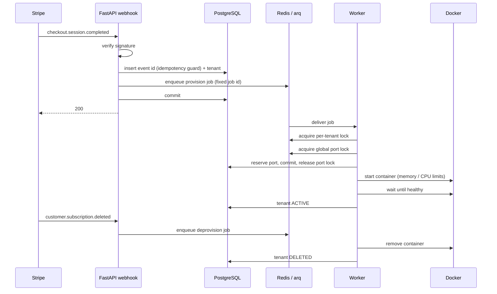
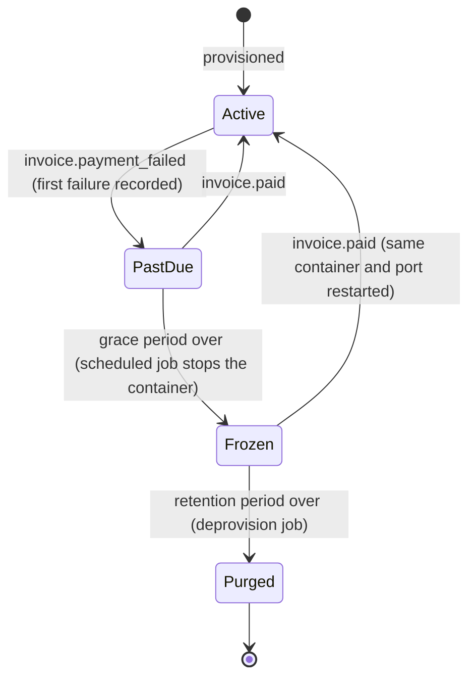

# Stripe → Provisioning Pipeline

A small, runnable reference implementation of an automated tenant-provisioning flow:
a **Stripe webhook** triggers a **background job** that reserves a port, starts an isolated, resource-limited **Docker container** for the customer and waits for it to become healthy. Failed payments **freeze** the tenant (container stopped, data kept) and long-unpaid tenants are **purged** later.

It is a simplified, generic version of patterns used in a multi-tenant SaaS platform. No product-specific logic is included.

[](../../actions/workflows/ci.yml)

## Flow



Tenant states: `pending → provisioning → active`, `failed → provisioning` (retry), `active → frozen → active` (payment resumes), `deprovisioning → deleted`.

### Billing lifecycle



## Design decisions

| Concern | Approach |
|---|---|
| **Duplicate webhooks** | The Stripe event id is a primary key in `processed_events`. A replay violates it and is acknowledged without side effects. |
| **Lost jobs** | The job is enqueued *before* the database commit. If Redis is down, nothing is stored, the API returns 500 and Stripe retries the event. |
| **Duplicate jobs** | Fixed job ids (`provision:<tenant>`) make enqueueing idempotent in arq. |
| **Concurrent workers** | A per-tenant Redis lock (`SET NX EX` + owner token, released via Lua compare-and-delete) serialises provision and deprovision for the same tenant. A busy lock triggers a deferred retry. |
| **Safe retries** | Infrastructure operations are idempotent: `ensure_running` and `remove` can be called repeatedly. |
| **Out-of-order events** | Cancellation before provisioning wins: the provision job sees `deprovisioning` and skips. Cancellation for an unknown customer is ignored. |
| **Failures** | The error is stored on the tenant (`failed`, `last_error`) and the job is retried with backoff (max 5 tries). |
| **Partial failures** | Each completed step registers a compensation (release port, remove container). On failure they run in reverse order, so a retry starts from a clean slate. The compensation list is local to one job, never shared state. |
| **Port allocation** | The port is reserved in the database *inside* a global lock, before the lock is released. A UNIQUE column backs this up. Recording it later (after the container starts) would let two concurrent jobs pick the same port. |
| **Lock semantics** | The wait time is separate from the TTL. Release compares an owner token, so a holder whose lock expired cannot delete the next owner's lock. |
| **Unpaid customers** | A scheduled job freezes tenants after a grace period (container stopped, data kept) and queues a purge after the retention period. Paying an invoice resumes the same container and port. |
| **Cleanup failures** | Removal errors are raised, not swallowed: the tenant stays `deprovisioning` and the job is retried, instead of being marked deleted while resources still run. |
| **Isolation** | One container per tenant with memory and CPU limits (enforced through cgroups). |

## Run the tests

```bash
pip install -r requirements-dev.txt
pytest -q
```

The suite uses SQLite, `fakeredis` and a fake provisioner, so it needs no Docker, Redis or Stripe account.

## Run the whole stack

```bash
cp .env.example .env        # DEV_MODE=true is already set for local testing
docker compose up --build
```

The API is at `http://localhost:8000` (interactive docs at `/docs`).
Set `PROVISIONER=fake` in `.env` if you do not want real containers (the worker then does not need the Docker socket).

## Try it with Postman (no Stripe account needed)

1. Import `postman/qeakflow-provisioning.postman_collection.json`.
2. Run the requests in order. After each step call **List tenants** (`GET /dev/tenants`) to see the result.

| Step | Request | What you should see |
|---|---|---|
| 1 | `checkout.session.completed` | `provisioning_queued`; a moment later the tenant is `active` with a port (from 20000) and a container |
| 2 | Same event id twice | `provisioning_queued`, then `duplicate` |
| 3 | `invoice.payment_failed` | `past_due_recorded` (the first failure date is kept) |
| 4 | `POST /dev/lifecycle?freeze_days=0` | tenant becomes `frozen`, container stopped |
| 5 | `invoice.paid` | `unfreeze_queued`; tenant `active` again, same container and port |
| 6 | `customer.subscription.deleted` | tenant `deleted`, container removed, port released |

With real containers you can also open `http://localhost:<port>` for a tenant (the demo image just echoes the request) and run `docker ps --filter label=app=provisioning-demo`.

`DEV_MODE=true` makes the webhook accept **unsigned** JSON and mounts the `/dev` helper endpoints. **Never enable it on a public deployment.** With `DEV_MODE=false` the endpoint requires a valid Stripe signature.

To test the signature check itself, run the API with `DEV_MODE=false` and use the signed sender:

```bash
python scripts/send_test_event.py checkout.session.completed cus_demo
```

## Project layout

```
app/
  main.py          FastAPI app factory
  webhook.py       signature check, idempotency, event dispatch
  queue.py         arq wrapper with fixed job ids
  worker.py        arq functions, lock + retry handling, nightly billing job
  dev.py           /dev helper endpoints (only with DEV_MODE=true)
  provisioning.py  provision / deprovision / lifecycle use-cases, port allocation, compensation
  provisioner.py   Docker implementation and an in-memory fake
  locks.py         distributed lock with owner token and wait time
  db.py            SQLAlchemy models
tests/             webhook, provisioning and lock tests
scripts/           signed test-event sender
postman/           Postman collection for the local walkthrough
```

## Known limitations

This is a demo. Things a production system would add:

- **Transactional outbox.** Enqueue-then-commit leaves a small window where a job can run for a transaction that later failed to commit. The worker tolerates this by retrying until the tenant row is visible, but an outbox table would remove the gap.
- **Migrations** (Alembic) instead of `create_all`.
- **Docker socket access.** Mounting `/var/run/docker.sock` gives the worker root-equivalent control of the host. Use a restricted socket proxy or a dedicated orchestrator in production.
- **Lock renewal / fencing tokens** when an operation (for example a slow health check) can outlive the lock TTL.
- A real per-tenant database and service configuration step, plus notifications (e-mail) on freeze and purge.
- Per-tenant networking, persistent volumes, metrics and alerting.
